# Implementación de Automatización de Hardening y Auditoría CIS Benchmark (Cisco IOS & FortiOS)

[](https://youtu.be/O-XU1Ox2bSA)

**Autor:** Manuel Alejandro Cruz Messón

**Matrícula:** 2025-0689

**Asignatura:** Seguridad de Redes

**Enlace del Video Demostrativo:** https://youtu.be/O-XU1Ox2bSA

---

### 1. Propósito del Laboratorio

El propósito fundamental de este laboratorio es diseñar, auditar y asegurar una infraestructura de red corporativa emulada (compuesta por un Router L3, un Switch L2 y un Firewall Perimetral), implementando políticas de seguridad basadas en el estándar **CIS Benchmark**. Asimismo, se busca desarrollar una herramienta de gestión automatizada mediante lenguajes de scripting (Python) que permita mitigar las vulnerabilidades de configuración de manera dinámica.

A través de esta implementación se persiguen los siguientes fines específicos de seguridad y administración de redes:

*   **Auditoría de Cumplimiento Normativo:** Evaluar la superficie de ataque de los dispositivos de red frente a configuraciones por defecto inseguras, utilizando herramientas de análisis de vulnerabilidades (Nmap) para detectar algoritmos criptográficos obsoletos y protocolos de gestión en texto plano.
*   **Automatización de Remediación (Hardening):** Desarrollar un script en Python 3 apoyado en la librería `Netmiko` y expresiones regulares (`re`), capaz de inyectar configuraciones de mitigación de forma masiva y concurrente, reduciendo el margen de error humano en la operación.
*   **Aplicación del Principio de Defensa en Profundidad:** Erradicar el uso de protocolos inseguros (Telnet, HTTP) en las interfaces de gestión, forzar el uso de criptografía fuerte (SSHv2), proteger los secretos locales mediante algoritmos de encriptación y establecer límites de inactividad de sesión administrativa.
*   **Trazabilidad y Respaldo Dinámico:** Generar reportes automatizados (en formato Markdown) que evidencien el estado de los controles CIS antes y después de la remediación, además de extraer y respaldar de manera desatendida los archivos de configuración en ejecución (`running-configs`) de los nodos protegidos.

---

### 2. Resumen y Alcance del Laboratorio

Este laboratorio integra una solución de automatización y seguridad perimetral para dispositivos Cisco IOS y Fortinet FortiOS, conectando un Router de borde, un Switch de acceso y un Firewall dentro del emulador PNetLab, gestionados desde una estación Ubuntu Server.

**Objetivos Clave Ejecutados:**
1.  **Segmentación y Direccionamiento IP:** Cálculo e implementación del direccionamiento de red (VLSM) basado en los dígitos de la matrícula del estudiante (2025-0689), estableciendo una red de gestión dedicada (10.25.89.0/24) y un enlace de tránsito seguro (172.25.89.0/30).
2.  **Análisis de Vulnerabilidades (Pre-Hardening):** Ejecución de scripts NSE de Nmap para evidenciar la exposición de servicios inseguros y confirmar la necesidad de aplicar el CIS Benchmark.
3.  **Desarrollo de Script de Hardening:** Programación de una herramienta con menú interactivo que soporta un modo de "Solo Auditoría" (lectura) y un modo de "Aplicación de Reglas" (escritura/remediación).
4.  **Endurecimiento de Dispositivos (CIS Benchmarks):** Aplicación exitosa de 6 controles críticos de seguridad en los entornos Cisco IOS y FortiOS para asegurar los planos de administración.

---

### 3. Topología de Red y Plan de Direccionamiento

La infraestructura se compone de un segmento de tránsito perimetral y un segmento LAN corporativo segmentado en VLANs (Usuarios y Gestión), estructurado bajo las redes derivadas de la matrícula `x.25.89.x`.

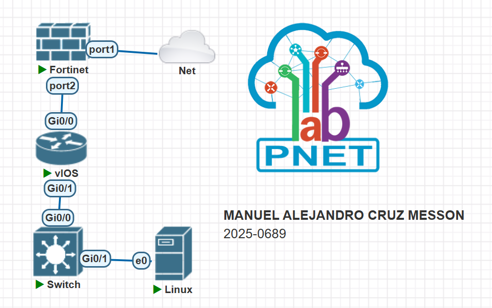

**Matriz de Conectividad e Interfaces**

| Dispositivo | Rol de Red | Interfaz / VLAN | Dirección IP / Prefijo | Gateway Predeterminado |
| :--- | :--- | :--- | :--- | :--- |
| **FW-FortiGate** | Firewall Perimetral (Salida WAN) | port1 (WAN) | Dinámica (DHCP Cloud) | Proveedor WAN |
| **FW-FortiGate** | Firewall Perimetral (Tránsito) | port2 (LAN) | 172.25.89.2/30 | N/A (Enrutamiento Estático) |
| **R1-Core (vIOS)** | Router L3 / Gateway LAN | Gi0/0 (Hacia FW) | 172.25.89.1/30 | 172.25.89.2 |
| **R1-Core (vIOS)** | Router L3 / SVI Gestión | Gi0/1.99 | 10.25.89.1/24 | N/A |
| **SW1-LAN (vIOS)** | Switch L2 / Acceso | Vlan 99 | 10.25.89.2/24 | 10.25.89.1 |
| **Ubuntu Server** | Gestión y Scripting (NMS) | eth0 | 10.25.89.10/24 | 10.25.89.1 |

---

### 4. Matriz de Controles de Seguridad (CIS Benchmark)

Se seleccionaron y justificaron las siguientes políticas de seguridad para endurecer el plano de gestión de los dispositivos:

| Dispositivo Objetivo | Control CIS Aplicado | Justificación Técnica de Seguridad |
| :--- | :--- | :--- |
| **Cisco IOS (R1/SW1)** | Encriptación de Contraseñas | (`service password-encryption`) Evita la exposición de credenciales en texto plano en caso de extracción no autorizada del archivo de configuración. |
| **Cisco IOS (R1/SW1)** | Forzar SSH Versión 2 | (`ip ssh version 2`) Mitiga ataques de downgrade e interceptación presentes en SSHv1, obligando el uso de criptografía fuerte para gestión remota. |
| **Cisco IOS (R1/SW1)** | Timeout de Sesión VTY | (`exec-timeout 5 0`) Previene accesos no autorizados mediante el secuestro de sesiones CLI abandonadas, forzando la desconexión tras 5 minutos. |
| **FortiGate (FW)** | Timeout de Administrador | (`set admintimeout 5`) Limita la ventana de oportunidad de ataques de fijación de sesión en la GUI/CLI tras periodos de inactividad. |
| **FortiGate (FW)** | Banner Pre-Login | (`set pre-login-banner enable`) Cumple con los requerimientos legales disuasorios, advirtiendo a los usuarios sobre el acceso restringido y monitoreado. |
| **FortiGate (FW)** | Bloqueo de Protocolos Inseguros | (Eliminación de HTTP/Telnet) Previene ataques de tipo Man-in-the-Middle y robo de credenciales en el segmento LAN (`port2`). |

---

### 5. Auditoría Inicial de Vulnerabilidades (Herramienta Externa)

**Objetivo:** Demostrar el estado vulnerable de la infraestructura (Pre-Hardening) utilizando Nmap y scripts NSE.
**Comando ejecutado:** `nmap -Pn -sV -p 22,23,80,443 --script ssh2-enum-algos 172.25.89.1 172.25.89.2 10.25.89.2`

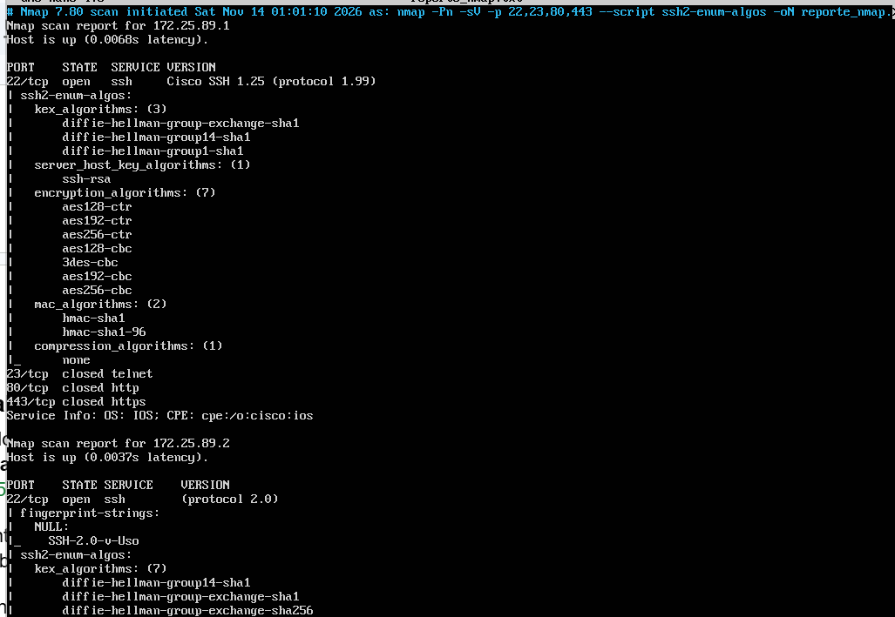
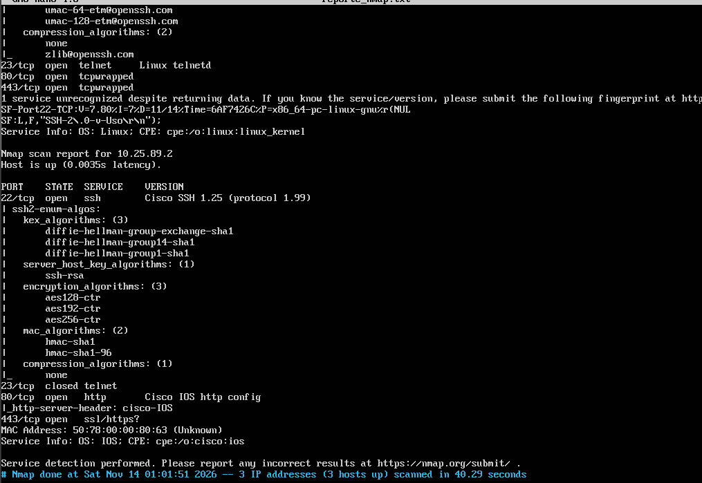

**Resultado:** El escaneo confirmó el incumplimiento del CIS Benchmark: los dispositivos Cisco exponían la versión 1.99 de SSH (permitiendo algoritmos obsoletos), mientras que el Firewall FortiGate mantenía abiertos los puertos 23 (Telnet) y 80 (HTTP) permitiendo la gestión administrativa sin cifrado.

---

### 6. Desarrollo del Script de Automatización (Python)

Se programó la herramienta automatizada `hardening.py`, la cual orquesta la recolección de datos y el aprovisionamiento de las reglas de seguridad. El sistema lee un archivo de inventario `devices.json` estructurado de la siguiente manera:

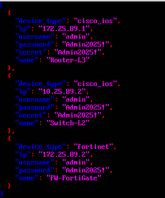
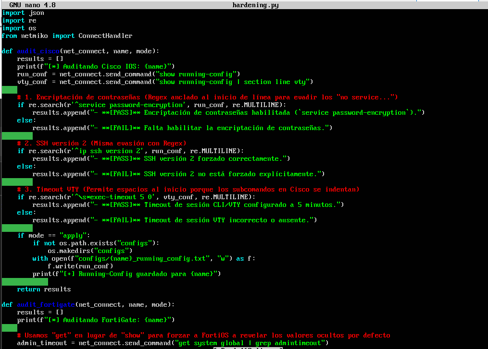


**Características del motor automatizado:**
*   **Netmiko:** Maneja la negociación SSH y autenticación a través de múltiples vendors (`cisco_ios` y `fortinet`).
*   **Módulo Regex (`re`):** Utiliza expresiones regulares ancladas para evitar falsos positivos (por ejemplo, diferenciando `service password-encryption` de `no service password-encryption`).
*   **Generación de Informes y Backups:** Crea automáticamente reportes Markdown (`.md`) y exporta configuraciones en formato texto.

---

### 7. Pruebas y Evidencias de Validación

#### 7.1. Ejecución del Modo Auditoría Pasiva (Sin Cambios)
**Objetivo:** Validar que el script es capaz de identificar las vulnerabilidades de configuración sin alterar la operatividad de la red. Se seleccionó la **Opción 1** del menú.

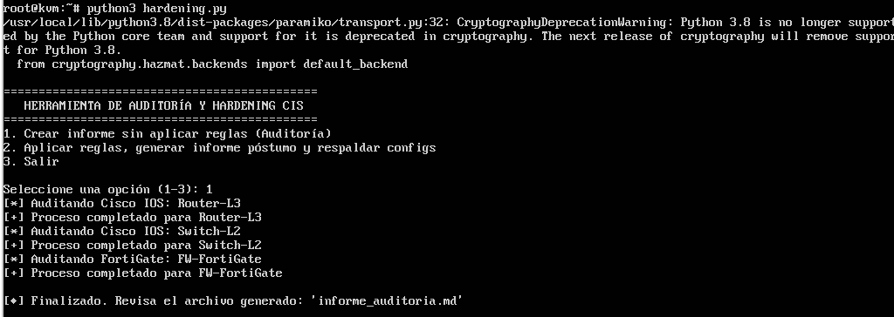
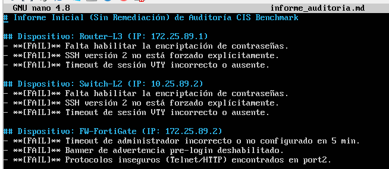

**Resultado:** El script interactuó con los tres nodos, extrajo el estado de las variables de configuración y generó el `informe_auditoria.md`, reprobando correctamente las directrices ausentes.

#### 7.2. Ejecución del Modo Remediación y Respaldo
**Objetivo:** Inyectar masivamente los comandos de endurecimiento en los dispositivos y extraer la configuración final segura. Se seleccionó la **Opción 2** del menú.

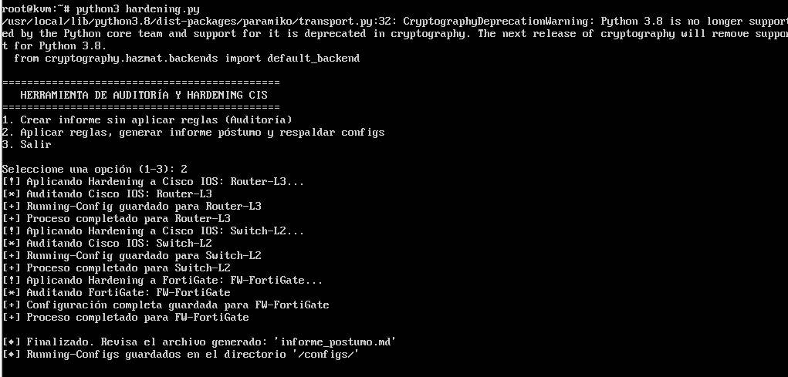

**Resultado:** La herramienta estableció conexión privilegiada, remitió los bloques de configuración de mitigación para Cisco IOS y FortiOS, guardó los cambios en memoria NVRAM y exportó con éxito los tres archivos `running-config.txt` al directorio local.

#### 7.3. Validación Póstuma Automatizada
**Objetivo:** Comprobar mediante el mismo script que los cambios inyectados revirtieron el estado de vulnerabilidad.

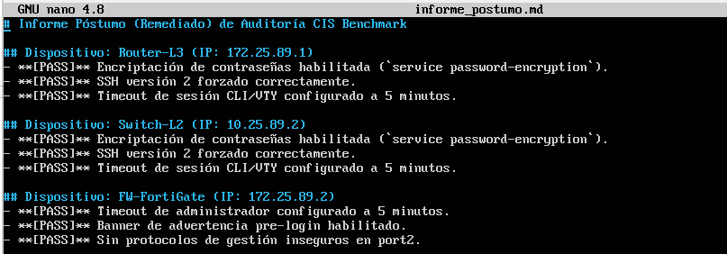

**Resultado:** El análisis post-remediación demostró un cumplimiento del 100% en las políticas evaluadas en los tres dispositivos de red, certificando la efectividad del código.

#### 7.4. Verificación Manual de Políticas
**Objetivo:** Confirmar desde el plano de datos que las políticas de defensa en profundidad operan correctamente.

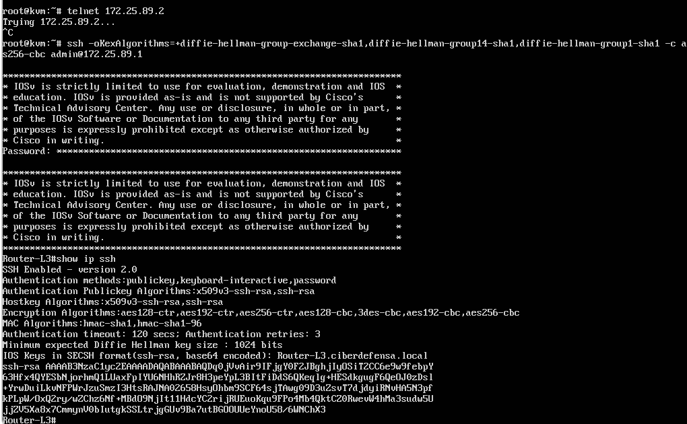

**Resultado:** Se comprobó la mitigación efectiva; los intentos de conexión mediante protocolos en texto plano (Telnet) hacia el Firewall fueron denegados por la interfaz de red, y los túneles administrativos ahora exigen obligatoriamente algoritmos criptográficos robustos.

### 7.5. Validación de Encriptación de Contraseñas (Cisco IOS)
* **Objetivo:** Demostrar que el control de mitigación CIS se aplicó correctamente y que las credenciales locales de administración ya no se almacenan ni se exponen en texto plano dentro de la memoria del equipo.
* **Comandos probados en consola Cisco:** `show running-config | include password` y `show running-config | include username`

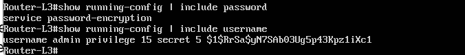

* **Resultado:** La configuración refleja el comando `service password-encryption` activo. Todas las contraseñas locales y de los puertos VTY han sido hasheadas (encriptación tipo 7), protegiendo las credenciales contra la lectura directa si el archivo de configuración es comprometido.

### 7.6. Validación de Banner de Advertencia Pre-Login (FortiGate)
* **Objetivo:** Comprobar que el firewall presenta un aviso legal disuasorio antes de solicitar credenciales o permitir el acceso, cumpliendo con el requisito legal de notificar que el sistema es de acceso restringido y está siendo monitoreado.
* **Comandos probados desde Ubuntu Server:** `ssh -oKexAlgorithms=+diffie-hellman-group14-sha1,diffie-hellman-group1-sha1 -c aes256-cbc admin@172.25.89.2`

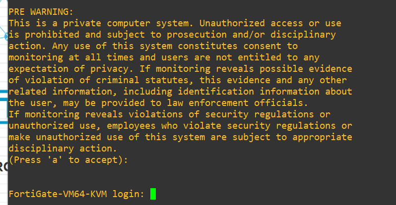

* **Resultado:** Al iniciar la conexión SSH, el sistema interrumpe el proceso de inicio de sesión estándar para imprimir el *Pre-login banner* configurado globalmente en FortiOS, requiriendo su lectura antes de exponer el prompt de contraseña.

---

### 8. Conclusiones

1.  **Reducción de Superficie de Ataque:** La correcta implementación de los controles sugeridos por el CIS Benchmark eliminó vectores críticos de compromiso, tales como la interceptación de credenciales (Man-in-the-Middle) mediante la deshabilitación de Telnet/HTTP y la restricción a protocolos criptográficamente seguros (SSHv2).
2.  **Eficiencia Operativa a través de la Automatización:** El desarrollo del script en Python demostró que el aprovisionamiento manual dispositivo por dispositivo es obsoleto y propenso a errores. El uso de librerías como Netmiko permitió auditar y remediar plataformas heterogéneas (Cisco y Fortinet) simultáneamente en cuestión de segundos.
3.  **Auditoría y Trazabilidad Continua:** La capacidad del sistema de generar reportes en formato Markdown y respaldar automáticamente los `running-configs` tras la aplicación de cambios establece un ciclo de vida de seguridad maduro, facilitando el análisis forense, el control de versiones de red y el cumplimiento continuo de normativas.

---

**Declaración de Uso de Inteligencia Artificial**

*   **Herramientas utilizadas:** Modelos de lenguaje e inteligencia artificial generativa asistieron en la consulta de sintaxis de expresiones regulares (Regex) para Python, diagnóstico de compatibilidad de intercambio de claves SSH (KexAlgorithms) entre Ubuntu y sistemas legados Cisco, y formateo estructural de la documentación técnica.
*   **Alcance del uso:** La herramienta sirvió de soporte analítico para la depuración de código de automatización de red y resolución de incompatibilidades de entorno durante el análisis de Nmap.
*   **Autoría y validación:** El diseño topológico, direccionamiento IP VLSM basado en matrícula, configuración e inicialización en PNetLab, estructuración lógica del script de Hardening y las pruebas manuales de validación de seguridad fueron desarrolladas, ejecutadas y comprobadas íntegramente por el autor del proyecto.
```
